# Pilot

[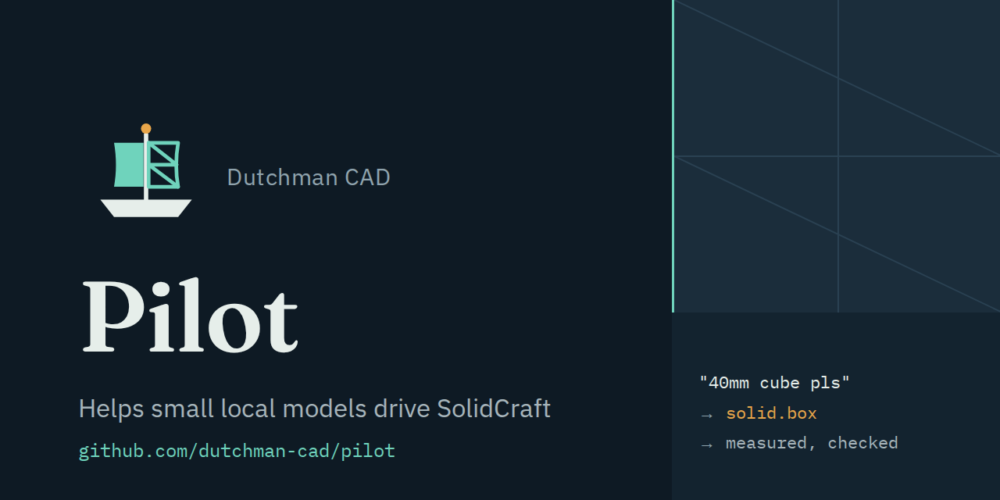](https://github.com/dutchman-cad/pilot/releases/latest)

Pilot lets a small AI model running on your own computer build parts in SolidCraft:
ask for "a 42 mm cube with a 5 mm hole through the middle" and it builds it, checked.

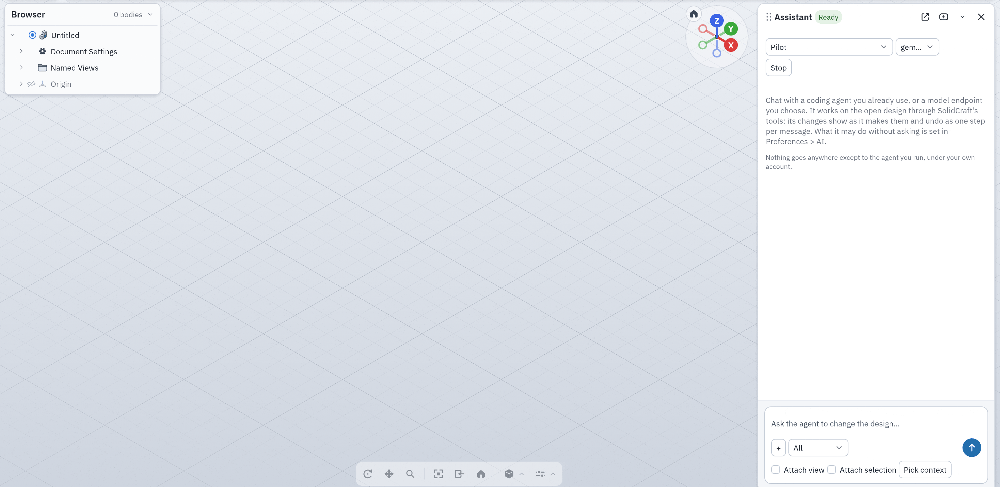

<sub>gemma4 e4b filling Pilot's plate form in SolidCraft 0.27.1. The wait for the model is shortened.</sub>

[](https://discord.gg/yTcseBEdeu)

## Get started

1. Install Pilot from [the latest release](https://github.com/dutchman-cad/pilot/releases/latest):

   | System | Command |
   | --- | --- |
   | macOS (Apple silicon) and Linux, with Homebrew | `brew install dutchman-cad/tap/dutchman-pilot` |
   | Windows, with Scoop | `scoop bucket add dutchman-cad https://github.com/dutchman-cad/scoop-bucket; scoop install dutchman-cad/dutchman-pilot` |
   | Any, from the release archive | `sh install.sh` (or `.\install.ps1` on Windows) in the extracted folder |

2. Run a local model with [Ollama](https://ollama.com), then start Pilot in front of it:

   ```sh
   ollama pull gemma4:e4b
   dutchman-pilot model --upstream http://localhost:11434/v1
   ```

3. In SolidCraft's Assistant, add an API agent with base URL `http://127.0.0.1:11500/v1`
   and model `gemma4:e4b`. Then ask for a part.

Stuck? See [First-run help](docs/first-run.md). More options are in the
[Assistant guide](docs/assistant.md) (LM Studio, and Pilot without a model) and the
[install guide](docs/install.md).

## What it can build today

Each of these was built by Pilot in SolidCraft 0.27.1 from the request under it.

<table>
  <tr>
    <td align="center" width="25%">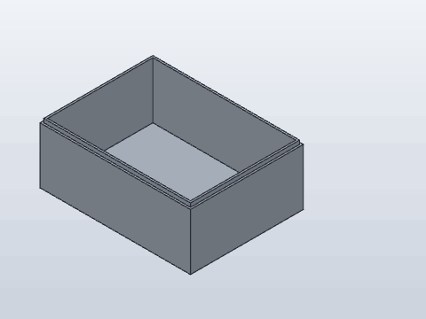<br><sub>“an 80 x 60 x 30 mm enclosure with 2 mm walls and a lip for the lid”</sub></td>
    <td align="center" width="25%">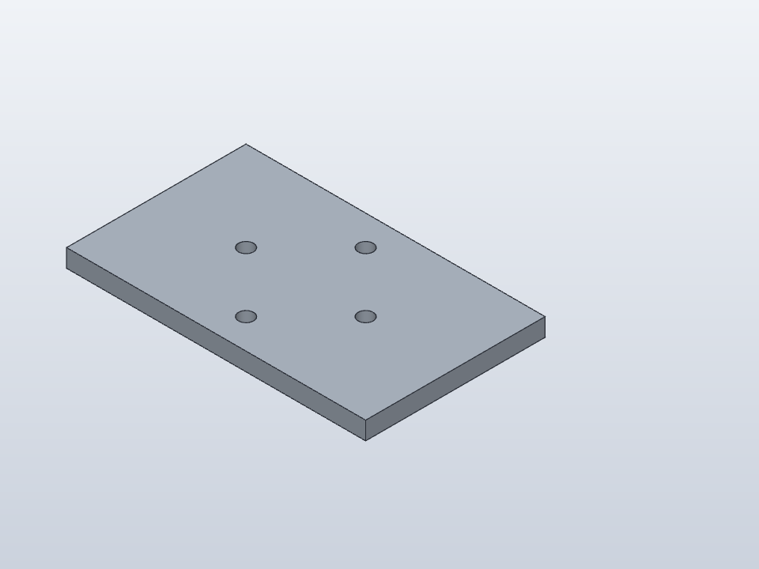<br><sub>“a 100 x 60 x 6 mm plate with four 5 mm holes on a 40 mm bolt circle”</sub></td>
    <td align="center" width="25%">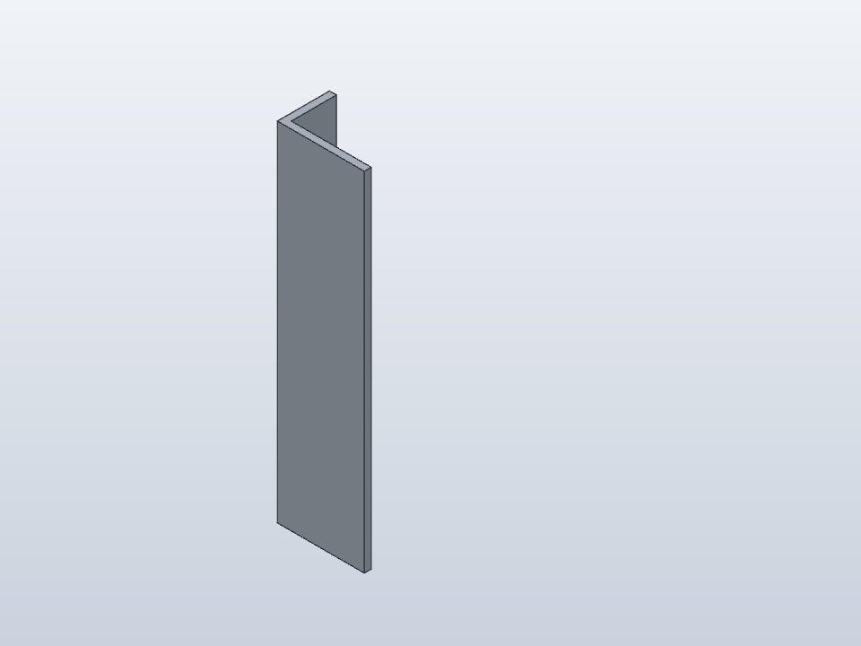<br><sub>“an L profile 50 x 30 x 4 mm, 200 mm long”</sub></td>
    <td align="center" width="25%">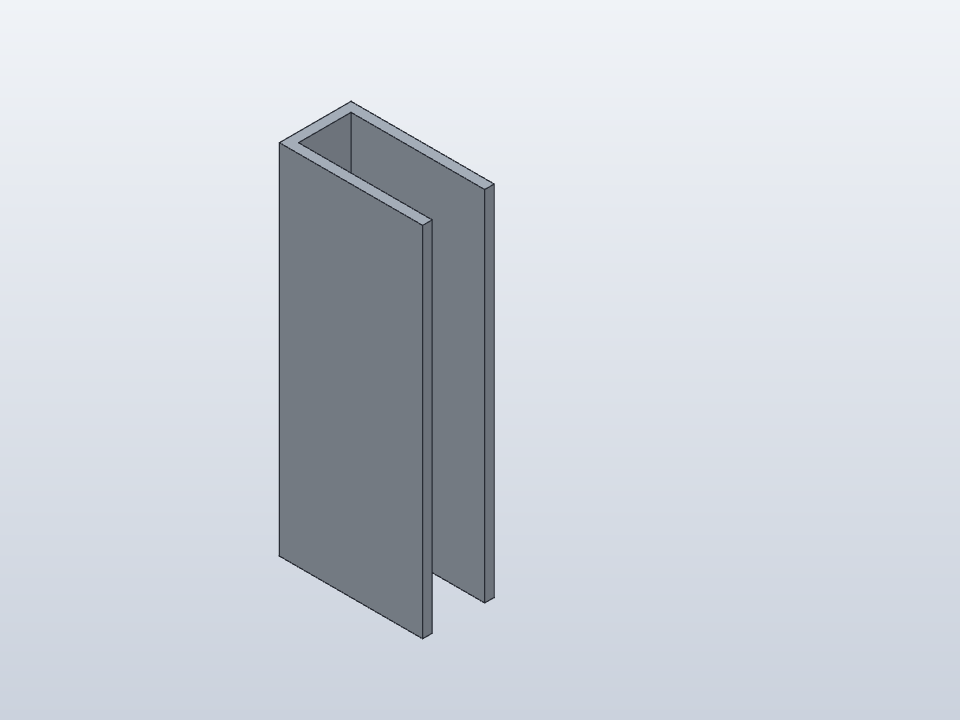<br><sub>“a C channel 60 mm wide with 30 mm flanges, 4 mm thick and 150 mm long”</sub></td>
  </tr>
  <tr>
    <td align="center" width="25%">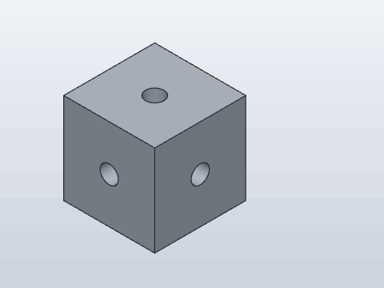<br><sub>“a 40 mm cube with 8 mm holes through all six faces”</sub></td>
    <td align="center" width="25%">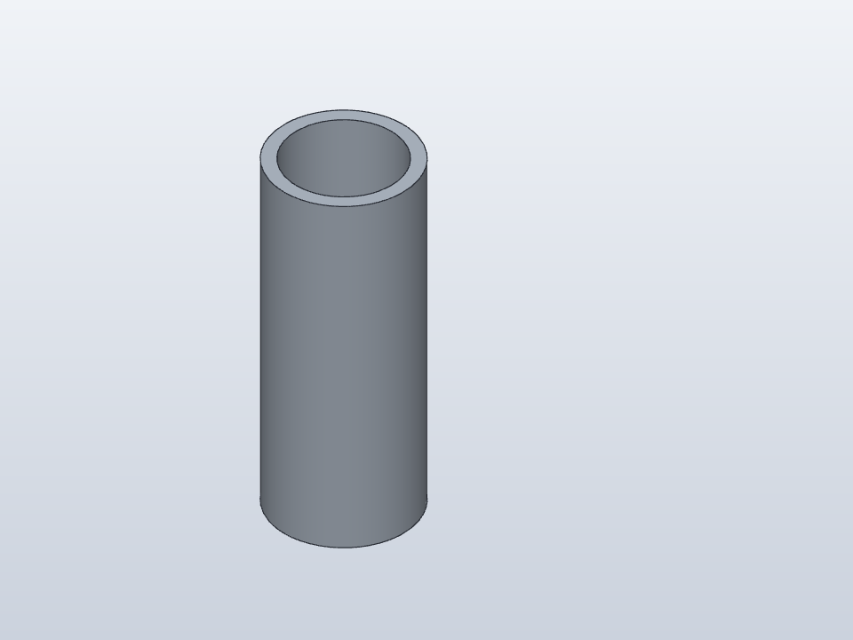<br><sub>“a tube 40 mm outside diameter, 32 mm inside diameter, 100 mm long”</sub></td>
    <td align="center" width="25%">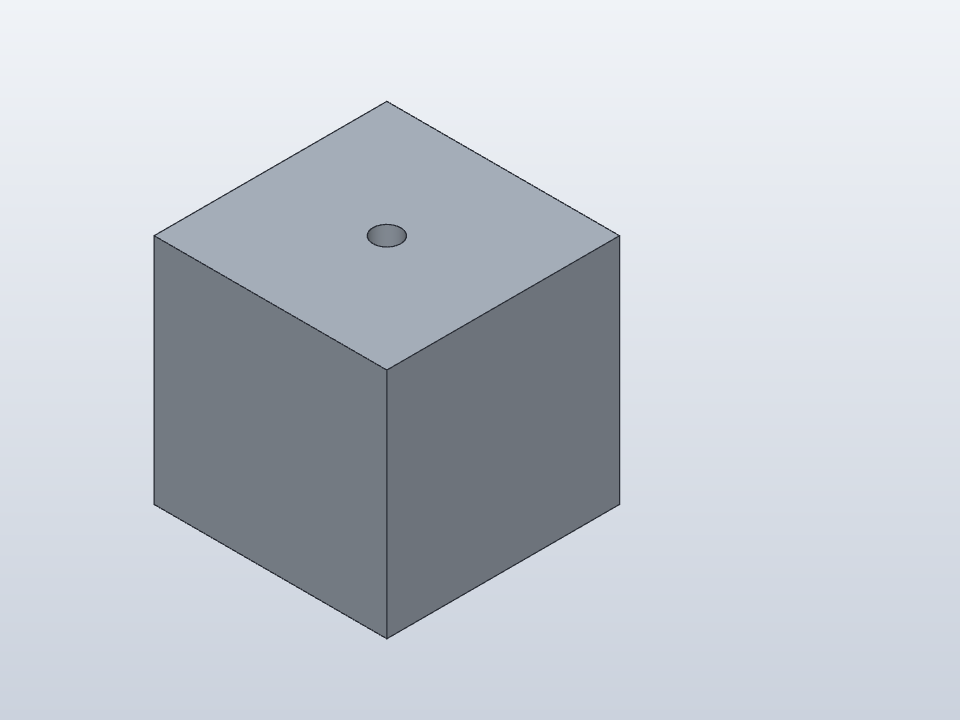<br><sub>“a 42 mm cube with a 5 mm hole through the middle”</sub></td>
    <td align="center" width="25%">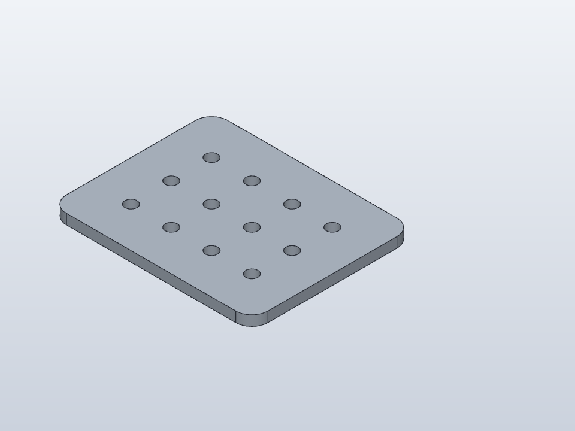<br><sub>“a 100 x 80 x 5 mm plate with 8 mm rounded corners and a 3 by 4 grid of 6 mm holes 20 mm apart”</sub></td>
  </tr>
  <tr>
    <td align="center" width="25%">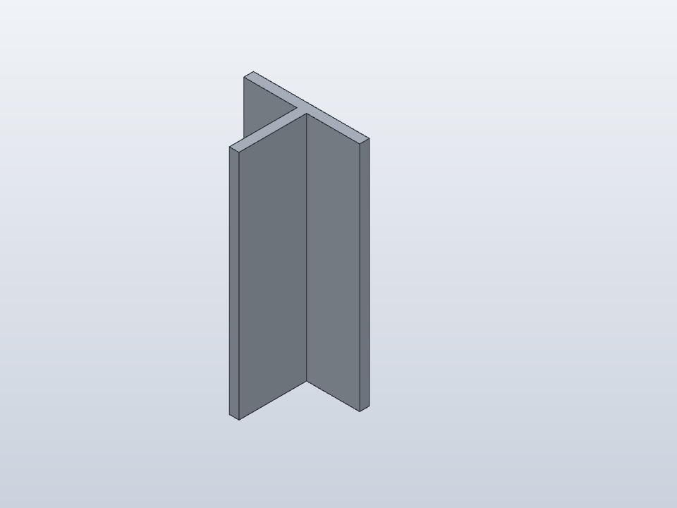<br><sub>“a T section 60 mm wide, 40 mm tall, 5 mm thick, 120 mm long”</sub></td>
    <td align="center" width="25%">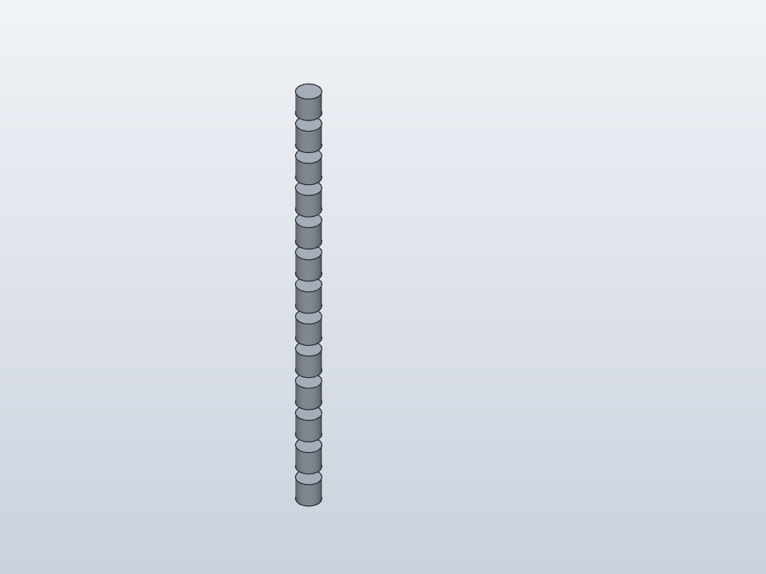<br><sub>“a cylinder 10 mm across and 10 mm tall” then “make 12 copies of it in a row, 15 mm apart”</sub></td>
    <td align="center" width="25%">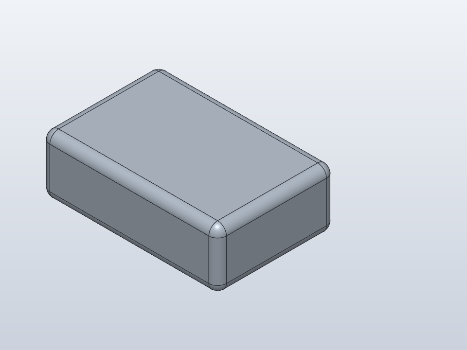<br><sub>“a 60 x 40 x 20 mm box” then “round all edges 3 mm”</sub></td>
  </tr>
</table>

The full list:

- Boxes, cylinders, tubes, and spheres, with holes through them
- Holes, bolt circles, hole grids, honeycomb cuts, and cross-drilled blocks
- Plates with holes, bores, and rounded corners
- L, T, U, C, and rectangular profiles
- Enclosures with walls, a floor, and a lip for the lid
- Joints between parts, including a revolute joint on a pin
- Patterns of parts you already have
- Edits: fillets, chamfers, shells, mirrors, revolves, moves, and renames, plus measurements

Each kind and its limits are in [recipes](docs/recipes.md).

## How it works

1. You ask SolidCraft's Assistant for a part in plain words.
2. Pilot finds the recipe that fits, such as a plate, a profile, or an enclosure.
3. The model fills in that recipe's short typed form: sizes, counts, and positions. When
   Pilot can read every value from the request itself, it skips the model.
4. Pilot turns the form into SolidCraft commands, you approve them, and SolidCraft builds
   the part. Pilot measures the result and reports it.

A small model is much better at filling in a short form than at writing CAD commands from
scratch, and SolidCraft checks every command before it runs.

## How well it works

Pilot is an early beta. On four blind test sets (56 requests never used during development),
gemma4 e4b builds about 38 of the 56 requests (67%) correctly through Pilot on 0.1.0-beta.8
(fixed model settings, average of three runs). Full numbers, and results with other models, are in
[the results issue](https://github.com/dutchman-cad/pilot/issues/1).

## Models that work

- **gemma4 e4b** (`ollama pull gemma4:e4b`) is the recommended model and the one Pilot
  is measured with. It is small enough to run on many laptops.
- Larger models such as gemma4 12B and gemma4 26B did well in earlier tests. qwen2.5 7B,
  qwen3 14B, gpt-oss 20B, and llama 3.1 and 3.2 have also been tried.
- Any model served through Ollama, LM Studio, or another chat-completions endpoint can be
  used. Numbers for each are in [the results issue](https://github.com/dutchman-cad/pilot/issues/1).

## Privacy

Pilot runs on your computer and sends requests only to the model server you choose; with
Ollama or LM Studio, that is your own computer too. Pilot sends nothing anywhere else. Reports from `/report` are redacted, saved locally, and
only leave your computer if you submit the issue yourself.

## Limits

- It is an early beta: about a third of the blind test requests still fail, most often
  because the model fills in a wrong value.
- It builds the kinds of parts listed above. Freeform shapes, arbitrary sketches, and large
  edits to existing designs go to the model on its own, which a small model rarely gets right.
- Every set of commands waits for your approval in SolidCraft, and a part Pilot built without
  the model says so in its reply.

## Contributing

The most useful thing is a request that went wrong: type `/report` in the Assistant and
submit the issue it prepares. Ideas and questions are welcome on the
[Discord](https://discord.gg/yTcseBEdeu); code changes are described in
[contributing](CONTRIBUTING.md).

## Help and more

- Something wrong? Type `/report` in SolidCraft's Assistant. Pilot writes a redacted report and a
  prefilled [issue](https://github.com/dutchman-cad/pilot/issues) link you review before
  sending.
- Questions and discussion: the [Dutchman CAD Discord](https://discord.gg/yTcseBEdeu).
- Your own model's results: add them to [#1](https://github.com/dutchman-cad/pilot/issues/1).
- [Command-line options](docs/command-line.md): MCP clients, exact matches, trimming,
  text tool mode, and the planner. Every flag is in the [flags reference](docs/flags.md).
- [Behavior and limits](docs/details.md), [measuring it](docs/measure.md),
  [public benchmarks](bench/), and [plugin preparation](docs/plugin.md).
- [Changelog](CHANGELOG.md), [contributing](CONTRIBUTING.md),
  [security](SECURITY.md), and [the contract](SPEC.md).

## SolidCraft 98

A side extra: Pilot can also drive [SolidCraft 98](docs/solidcraft98.md) through its screen,
but not reliably yet. In an 11-task test with two runs each, gemma4 e4b built 2 of 22 parts
through Pilot (a cylinder, twice) and 6 of 22 on its own; qwen2.5 7B, granite4 3B, and Muse
Glimmer 30B built none either way.

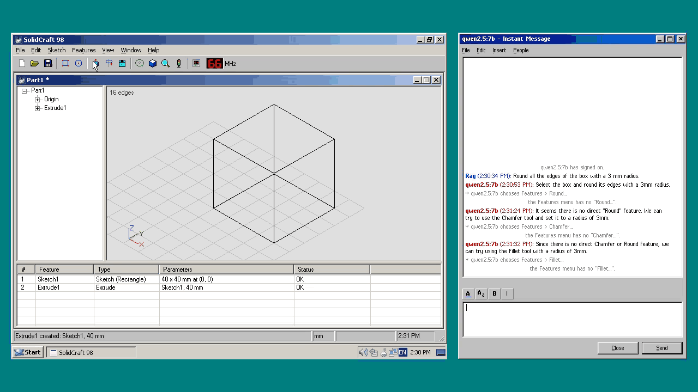

<sub>SolidCraft 98's own chat window with qwen2.5 7B, without Pilot, asked to round the edges of a
box that was set up beforehand. It did not finish.</sub>

Licensed under [Apache-2.0](LICENSE). See [NOTICE](NOTICE).
